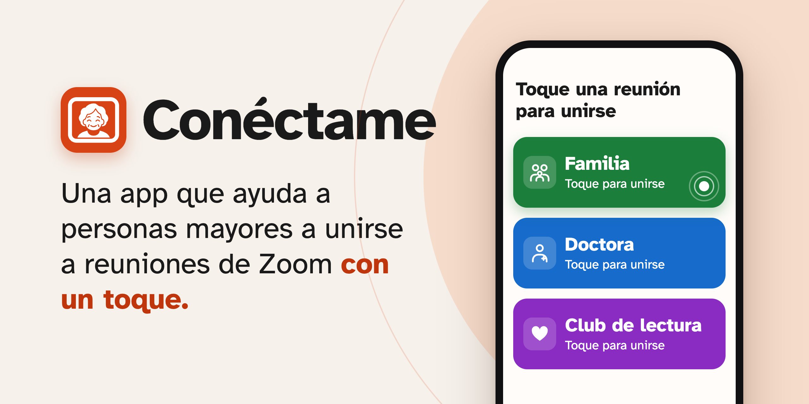
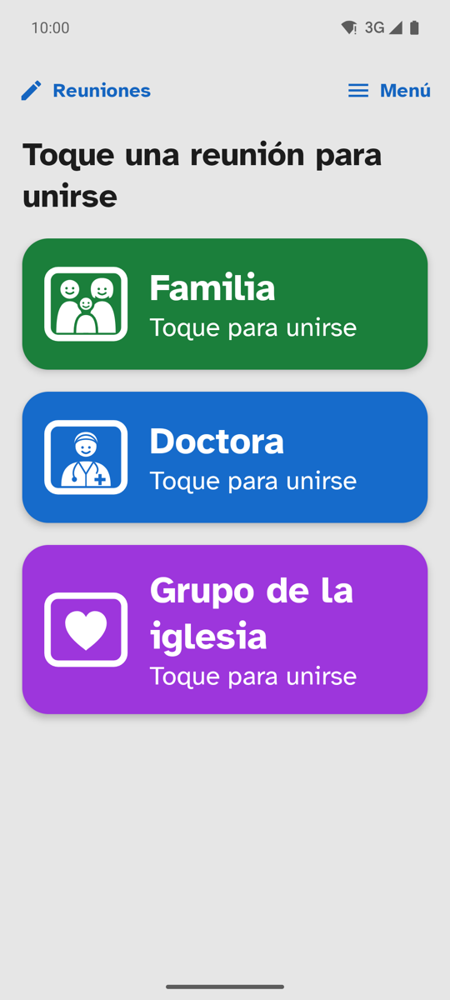
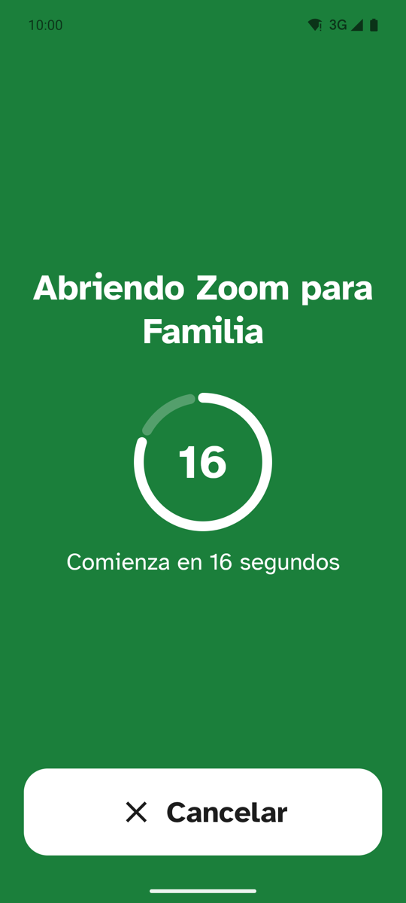
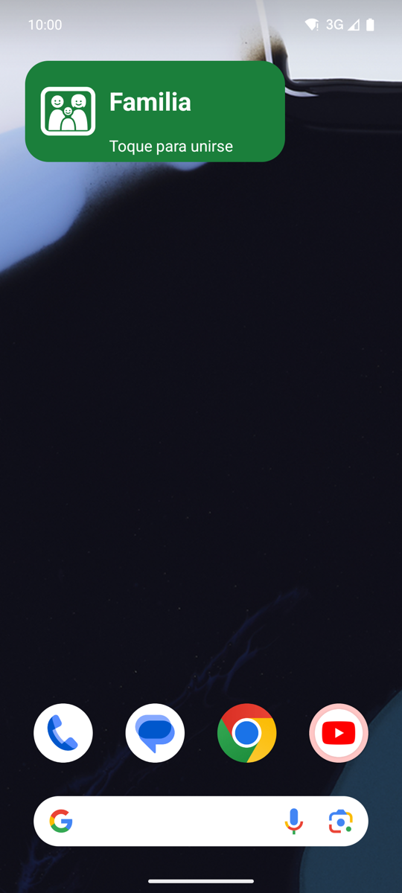
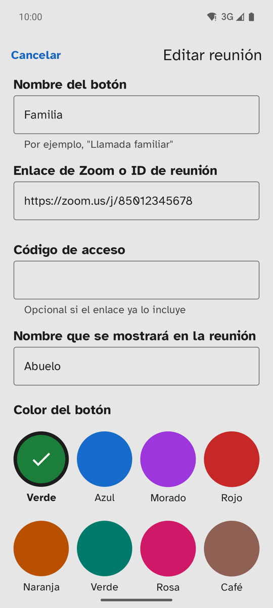
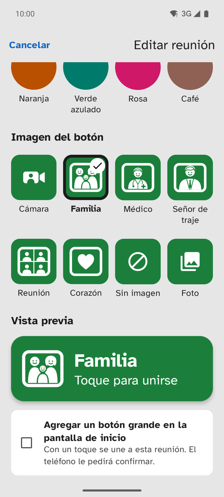
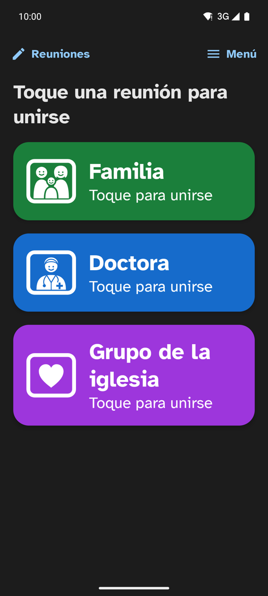

# Conéctame

Conéctame ayuda a personas mayores a unirse a reuniones de Zoom con un toque.

Un cuidador configura y guarda los datos de una reunión (enlace, código de acceso, nombre) y agrega
un botón grande en la pantalla de inicio del teléfono. La persona mayor solo tiene que tocarlo: la
app muestra a qué reunión va a entrar, espera 20 segundos (para poder cancelar un toque por error)
y abre Zoom directamente en la reunión.

La app está en español e inglés y sigue el idioma del teléfono.

> [!NOTE]
> Conéctame no está en Google Play por ahora. Para usarla hay que compilarla e instalarla desde
> Android Studio

## Capturas de pantalla

<table>
  <tr>
    <td align="center"><br>Pantalla principal</td>
    <td align="center"><br>20 segundos para cancelar</td>
    <td align="center"><br>Botón en la pantalla de inicio</td>
  </tr>
  <tr>
    <td align="center"><br>Configurar una reunión</td>
    <td align="center"><br>Imagen y vista previa</td>
    <td align="center"><br>Modo oscuro</td>
  </tr>
</table>

Las reuniones de las capturas son ejemplos.

## Por qué hice esta app

Hice Conéctame para un amigo mayor. Mi amigo no siempre tiene a alguien que le ayude a conectarse a
sus citas médicas o a otras de sus reuniones sociales. Así que hice esta app para guardar
todas sus reuniones, pueda unirse con un toque y logre un poco de independencia.

Hoy la app ya está instalada en su teléfono, y con eso cumplió su objetivo. Comparto el código para
que cualquiera pueda usarla, aprender de ella o adaptarla a quien la necesite.

### ¿Por qué no está en Google Play?

Publicarla requiere una cuenta de desarrollador de pago y un periodo de prueba cerrado con al menos
12 personas durante 14 días. Como la app ya cumple su propósito, por ahora no la he publicado.
Puede que lo haga más adelante.

## Funciones

- **Botones de reunión** grandes, con nombre, color e imagen (cámara, familia, médico, señor de
  traje, reunión, corazón, una foto propia o sin imagen).
- **Botón en la pantalla de inicio** (widget de 3×1) para cada reunión. En teléfonos que no permiten
  agregar widgets desde una app, se usa un acceso directo pequeño.
- **Menú** con:
  - **Configuración**: colores de la pantalla (igual que el teléfono / claro / oscuro) y tamaño del
    texto (normal / grande).
  - **Ayuda para el cuidador**: consejos para configurar y mantener las reuniones.
  - **Acerca de**: versión, descripción, privacidad y créditos.

## Accesibilidad

Pensada para personas con baja visión o poca experiencia con teléfonos:

- Letra [Atkinson Hyperlegible](https://brailleinstitute.org/freefont), diseñada para que las letras
  que se confunden fácilmente (I/l/1, O/0) se distingan bien.
- Textos grandes (nada menor a 16sp) que también crecen con el tamaño de letra del teléfono, más una
  opción "Grande" propia de la app.
- Colores que cumplen WCAG AA en modo claro y oscuro: texto blanco a 4.5:1 o más sobre cada color de
  botón, y el borde de cada botón a 3:1 o más contra el fondo. Una prueba automática lo verifica.
- Áreas de toque de 56dp o más, y textos y estados pensados para TalkBack.
- Sin enlaces que abran el navegador por accidente.

## Privacidad

Las reuniones se guardan en el teléfono (SharedPreferences) y la app no tiene permiso de internet.
Se copian solo con la copia de seguridad automática de Android o al pasar los datos a un teléfono
nuevo (`allowBackup="true"`).

## Requisitos

- Android 7.0 (API 24) o superior. El botón grande en la pantalla de inicio necesita Android 8.0+.
- La aplicación de Zoom instalada (si falta, la app ofrece instalarla).

## Desarrollo

Proyecto Android de un solo módulo (`:app`), en Kotlin con Jetpack Compose y Material 3.

```sh
./gradlew assembleDebug          # compilar la versión de prueba
./gradlew testDebugUnitTest      # pruebas unitarias (JVM, sin teléfono)
./gradlew lintDebug              # revisión de lint
./gradlew installDebug           # instalar en el teléfono conectado
```

Usa Gradle 8.14.5 (funciona con JDK 17 a 24, incluido el JDK que trae Android Studio).

### Estructura

```
app/src/main/java/com/nelsonurrutia/conectame/
├── MainActivity.kt          # punto de entrada, navegación y todas las pantallas (Compose)
├── AppSettings.kt           # Configuración guardada (colores, tamaño del texto) y AppTheme
├── Meeting.kt               # modelo de datos y ZoomLinkParser
├── MeetingRepository.kt     # guarda las reuniones (SharedPreferences, JSON)
├── ZoomLauncher.kt          # abre Zoom con el enlace zoomus://
├── MeetingWidget.kt         # botón grande de la pantalla de inicio (AppWidgetProvider)
├── WidgetConfigActivity.kt  # "¿Qué reunión abre este botón?"
├── MeetingShortcuts.kt      # crea y actualiza widgets y accesos directos
├── MeetingPhotos.kt         # fotos elegidas para los botones
├── MeetingColor.kt          # colores de los botones (con su regla de contraste)
├── MeetingIcon.kt           # imágenes de los botones
└── ui/theme/                # colores, tipografía y tema (claro y oscuro)
```

Las pruebas están en `app/src/test/`: `ZoomLinkParserTest` (lectura de enlaces de Zoom) y
`MeetingColorTest` (contraste de los colores).

## Licencias

El código está bajo la licencia MIT (ver `LICENSE`).

La letra Atkinson Hyperlegible es © 2020 Braille Institute of America, Inc., y se usa bajo la
SIL Open Font License 1.1 (ver `third_party/atkinson-hyperlegible/OFL.txt`).
